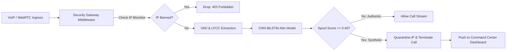

# 🛡️ True Tone SIH — Cyber Defense & Voice Anti-Spoofing Platform

[](https://www.python.org/)
[](https://pytorch.org/)
[](https://fastapi.tiangolo.com/)
[](#acoustic-deep-learning-engine)
[](LICENSE)

An enterprise-grade cyber defense platform engineered for the **Smart India Hackathon (SIH)**. True Tone couples a sub-50ms acoustic deep learning engine with an automated network IP firewall to intercept synthetic voices, voice clones, and deepfakes across VoIP, SIP, and WebRTC gateways in real-time.

---

## 🏛️ System Architecture



---

## 📂 Project Directory Structure

```
True-Tone-sih/
├── run_defense_system.py         # 🚀 Main entry point to launch FastAPI & Web Dashboard
├── context.md                    # Detailed architectural and operational specifications
├── README.md                     # High-level project documentation
│
├── models/                       # Checkpoints & Database Persistence
│   ├── best_audio_spoof_model.pt # Primary fine-tuned CNN-BiLSTM-Attention PyTorch model
│   ├── security_firewall.db      # SQLite database for persistent IP quarantine ledger
│   ├── confusion_matrix.png      # Validation confusion matrix plot
│   └── finetune_metrics.png      # Training metrics plot (EER, Loss, Accuracy, F1)
│
├── notebooks/                    # Interactive Jupyter Notebooks
│   └── finetune_model.ipynb      # Complete fine-tuning notebook with visual metrics
│
├── samples/                      # Reference audio clips for testing & demos
│   ├── sample_bonafide_human_voice.flac  # Verified authentic human voice
│   └── sample_spoof_ai_voice.flac        # Synthetic vocoder AI deepfake attack
│
├── src/                          # Application source code
│   ├── api/                      # Backend API Gateway
│   │   └── app.py                # FastAPI routes, WebSocket /ws/live-call, Jinja2 mounting
│   │
│   ├── audio/                    # Acoustic Machine Learning Pipeline
│   │   ├── model.py              # PyTorch AudioSpoofDetector (CNN + BiLSTM + Attention)
│   │   ├── features.py           # 60-dim LFCC feature extraction, VAD, Dynamic AGC
│   │   ├── detector_service.py   # Sub-50ms thread-safe inference engine singleton
│   │   ├── predict.py            # CLI prediction script
│   │   ├── train.py              # Core PyTorch training loop and EER computation
│   │   ├── train_scaled_dataset.py # Multi-dataset 24k balanced training script
│   │   ├── evaluate_multiple_datasets.py # Cross-dataset benchmarking
│   │   └── preprocess_cache.py   # High-speed feature caching utility
│   │
│   ├── security/                 # Firewall & Threat Mitigation
│   │   ├── ip_blocker.py         # Two-tier cache (L1 in-memory + L2 SQLite) manager
│   │   ├── middleware.py         # ASGI Security Middleware for real-time connection dropping
│   │   └── test_ip_blocking.py   # Automated pytest security tests
│   │
│   └── web/                      # Frontend Web Command Center
│       ├── README.md             # Frontend architecture documentation
│       ├── static/               # Client assets (modular CSS & JavaScript)
│       │   ├── css/              # Design tokens, variables, base, layout, components
│       │   ├── js/               # Modular WebRTC visualizer, WebSocket client, UI handlers
│       │   └── assets/           # Icons, badges, brand assets
│       └── templates/            # Modular Jinja2 template components
│           ├── base.html         # Common shell (head, meta, scripts)
│           ├── index.html        # Clean dashboard page assembling components
│           ├── components/       # Header, telemetry, live_call, firewall, incidents
│           └── pages/            # Roadmap and system architecture flowchart
│
├── docs/                         # Documentation, diagrams & architectural specifications
│   └── TRUE_TONE_FLOWCHART.html  # Interactive Mermaid system flowchart
│
├── tests/                        # Automated QA Test Suites
│   └── test_model_pipeline.py    # 15 automated ML test cases (latency, F1, VAD, EER)
│
└── scratch/                      # Temporary diagnostic & exploratory scripts
```

---

## ⚡ Quickstart

### 1. Install Dependencies
```bash
pip install -r requirements.txt
# Ensure PyTorch, FastAPI, Uvicorn, SoundFile, Scipy, and Scikit-learn are installed
```

### 2. Launch the Cyber Defense Platform
```bash
python run_defense_system.py
```
- **Web Command Center**: `http://localhost:8000`
- **Interactive Swagger API**: `http://localhost:8000/docs`
- **System Architecture Flowchart**: `http://localhost:8000/flowchart`
- **Strategic Roadmap**: `http://localhost:8000/roadmap`

### 3. Run Automated QA Tests
```bash
# Model & ML inference pipeline test suite:
pytest tests/test_model_pipeline.py -v

# IP firewall & security middleware test suite:
pytest src/security/test_ip_blocking.py -v
```

---

## 🎯 Key Performance Metrics
- **Validation EER**: `0.08%` (Equal Error Rate)
- **Validation Accuracy**: `> 99.7%`
- **Inference Latency**: `8 - 18 ms` (CPU) | `< 3 ms` (CUDA)
- **Target Parameter Footprint**: `< 1.5M parameters` (fits easily in 4GB VRAM)